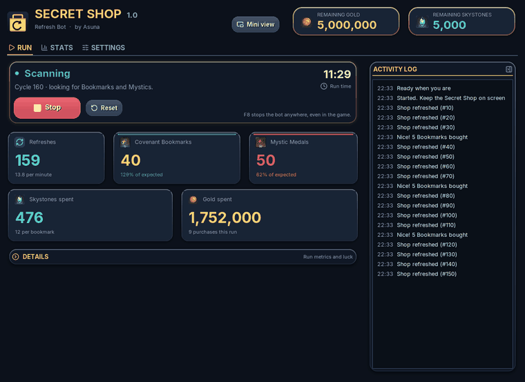
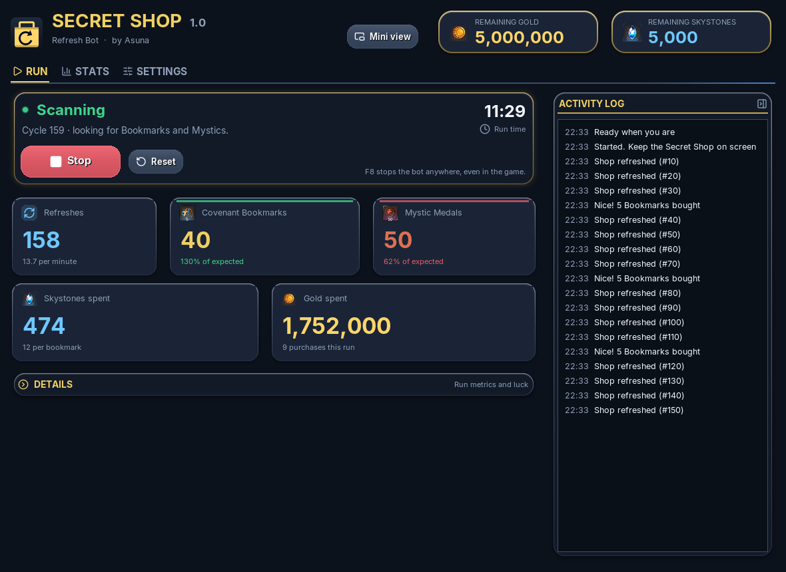
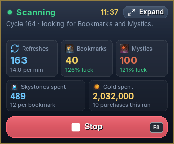
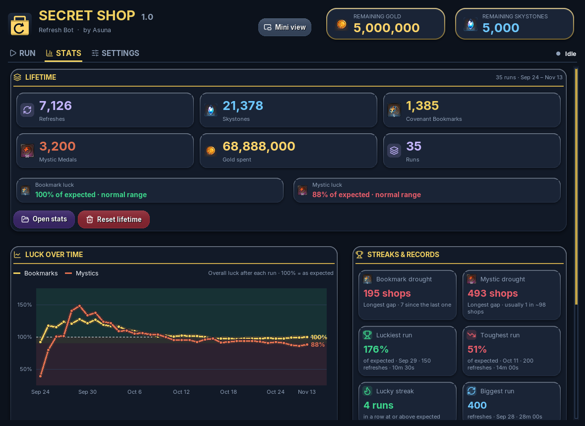
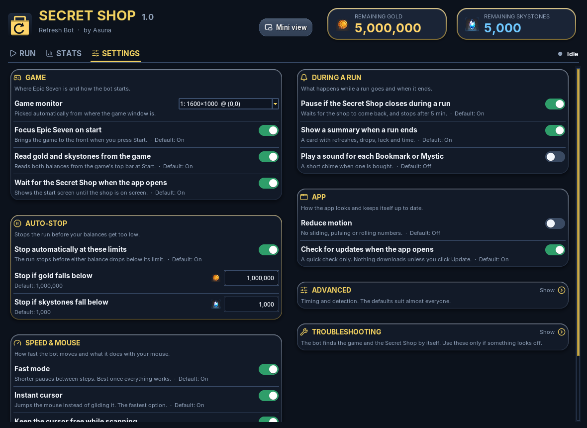

<p align="center"></p>

# ShopRefresh

**Automated Secret Shop refreshes for Epic Seven on Windows.**

ShopRefresh refreshes the Epic Seven Secret Shop for you, buys every **Covenant Bookmark** and **Mystic Medal** that appears, and stops at the limits you set. Every purchase is verified, every run is tracked, and nothing leaves your PC except a quick check for updates.

This repository hosts the official Windows releases. **[Download the latest version](https://github.com/asunakiyo/ShopRefresh/releases/latest)**

## Features

### Zero setup
- **Finds the game by itself** on any monitor and at any UI scale. A three-step start screen (**Open Epic Seven**, **Game visible**, **Open the Secret Shop**) opens the bot the moment the shop is on screen.
- **Reads your remaining gold and skystones** straight from the game's currency bar, then tracks every spend.
- **Pauses when the shop goes away** (another menu, a popup, a minimized game) and carries on by itself when it's back.

### Never misses a buy
- **Buys Covenant Bookmarks and Mystic Medals** in any row, including both in the same refresh.
- **Checks every slot before every refresh:** it scrolls to the top, checks, scrolls down and checks again, and never refreshes while a Bookmark or Mystic is still buyable.
- **Verified purchases:** a buy or refresh only counts once the game confirms it went through.

### You stay in control
- **Auto-stop limits:** set a gold floor and a skystone floor (defaults 1,000,000 and 1,000) and the run stops before you drop below them.
- **F8 emergency stop**, even while the game has focus.
- **Mini view:** a glassy, always-on-top overlay with live counters and one big **Start / Stop**.
- **Fast mode** and **Instant cursor** for speed once everything works.

### Rich tracking
- **Live Run tab:** refreshes, Covenant Bookmarks, Mystic Medals, skystones spent and gold spent, with your luck colour-coded against the official Secret Shop rates.
- **Lifetime stats and run history** (your last 500 runs), with luck shown as got vs expected.
- **Stats tab with charts:** luck over time, refreshes per run, and streaks and records (longest droughts, luckiest and toughest runs, lucky streaks, biggest run).
- **Session summary** when a run ends, which you can copy or save as an image.
- **Friendly activity log** in plain words, such as "Nice! 5 Bookmarks bought". The technical detail goes to a separate debug log.

### Safe and polished
- **Crash safety:** an unexpected error stops the bot cleanly, saves your stats and offers **Copy error report**, with your Windows user name and home folder removed.
- **Backups:** settings and stats are written safely with a backup, and a damaged file is restored from it automatically.
- **Plain-language problem cards**, each with one fix, for example "Game is covered by another window".
- **Update check at launch** and **one-click update** that verifies the download's size and SHA-256 before restarting into it. Your settings and stats carry over.
- **First-run quick tour**, **Reduce motion**, an optional purchase chime, and a polished interface with soft shadows, glass and gradient charts, pre-rendered so the bot stays fast.

## Screenshots

<p align="center"></p>

| Run tab | Mini view |
|:--:|:--:|
|  |  |
| **Stats tab** | **Settings tab** |
|  |  |

Screenshots use simulated runs.

## Download

Get the latest **`ShopRefresh-vX.Y.exe`** from the [Releases page](https://github.com/asunakiyo/ShopRefresh/releases/latest). Place it in its own folder and double-click it. No installation or Python is needed. Approve the Administrator prompt, because the game may ignore clicks otherwise.

**Requirements:** Windows 10 or 11, and the Epic Seven PC client in borderless or maximized window mode.

## Verify your download

Each release lists a SHA-256 checksum, a fingerprint of the exact file that was published. To confirm your copy is genuine and complete, run this in PowerShell from the download folder and compare the result with the checksum on the release page:

```powershell
Get-FileHash .\ShopRefresh-v1.0.1.exe -Algorithm SHA256
```

You can also run `ShopRefresh-v1.0.1.exe --self-test`, which checks the app without touching the game and writes `selftest.txt` ending in `PASS`.

## Updating

The app updates itself. When a new version is available, a notice appears with **Update**, **What's new**, and **Skip**, both on the start screen and at the top of the app. **Update** downloads the new exe next to the old one, checks its size and SHA-256 against the release, and restarts into it. Your `settings.json` and `lifetime_stats.json` carry over, and the old exe is tidied up on the next launch.

## Privacy

ShopRefresh stores its settings and statistics as plain files next to the exe. It stores no passwords or account details. Its only network requests are an optional update check against this repository's releases, which can be turned off in Settings, and the exe download when you press **Update**.

## Disclaimer

ShopRefresh is an unofficial, fan-made tool. It is not affiliated with, endorsed by, or supported by Smilegate or Epic Seven. Using third-party tools, macros, or bots may violate the game's Terms of Service and may result in account suspension or a permanent ban. Use this tool at your own risk. The authors accept no responsibility for any consequences arising from its use.
